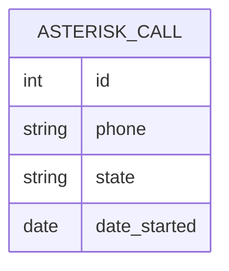

Le click-to-call manquait là où le PBX est un Asterisk/FreePBX : Odoo savait
envoyer des SMS par `voipms_sms` et piloter un Wazo par `wazo_phone`, mais pas
composer un appel sur l'interface ARI. Ce module comble ce seul trou : le trafic
voix passe par le PBX, le reste ne bouge pas. Il est séparé de `voipms_sms`
parce que le transport, l'API et les identifiants n'ont rien de commun.

L'approche reste volontairement minimale. Le client ARI
(`services/ari_client.py`) n'utilise que `urllib` de la bibliothèque standard,
en Basic auth `application:jeton`, et se limite aux cinq appels REST utiles.
Deux choix non évidents : un échec d'origination est écrit sur la ligne d'appel
(état Échec, message d'erreur) au lieu d'être relancé, car un rollback
effacerait cet état ; et le raccrochage est un meilleur effort — si l'appel a
déjà fini côté PBX, l'erreur ARI est seulement journalisée en debug.

Les réglages (URL, application, jeton) vivent dans `ir.config_parameter` sous
le préfixe `asterisk_ari.`, et le test de connexion interroge `GET /apps`. Le
numéro appelé est lu sur la fiche contact, l'identifiant appelant sur le
téléphone de la société courante : en multi-société, chaque société présente
donc son propre numéro. La fiche d'appel garde le contact en Many2one, sans le
posséder : supprimer le contact ne supprime pas l'historique.

## Modèle de données

