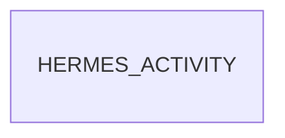

Dans Discuss, une conversation privée avec un agent Hermes ne dit rien de ce
que l'agent fait : ni étape en cours, ni durée, ni outil appelé. Ce module
ajoute cet indicateur, met en forme les réponses Markdown de l'agent et rend
opérationnels les boutons d'approbation du framework. Il est distinct de
`hermes_n1_audit`, qui possède la façade d'écriture métier : ici, rien n'est
écrit dans les objets métier, seulement l'état d'affichage du canal et le fil
de discussion.

L'état vit dans un champ Json (`hermes_activity_state`) du canal, mais son
écriture directe est refusée hors superutilisateur : seule la façade
`hermes.activity.publier` l'alimente, après avoir vérifié que l'appel vient
d'un compte agent et que le message source est celui d'un demandeur authentifié
(règle empruntée à `hermes_n1_audit`). Les mises à jour sont ordonnées par
`message_id` puis `sequence` : les plus anciennes, les doublons et tout ce qui
arrive après un état terminal sont ignorés, et l'historique est borné aux 50
dernières étapes.

Le Markdown est converti en HTML selon un ordre non négociable : tout est
échappé d'abord, seules les balises voulues sont réintroduites ensuite ; le
HTML fourni par le modèle n'est jamais exécuté. Les boutons d'approbation
postent la commande au nom de la personne qui clique, sans `sudo`, et aucun GET
n'écrit. La présence des agents est rafraîchie par le polling de la passerelle,
et une tâche planifiée les marque hors ligne après trois minutes sans
heartbeat. Les groupes reconnus sont ceux de `hermes_n1_audit`,
`hermes_n2_support` et `hermes_n3_infra` quand ces modules sont installés.

## Modèle de données

Le module n'enregistre aucun modèle persistant : `hermes.activity` est un `AbstractModel` (service d'état d'activité des agents (AbstractModel, sans table)). Le diagramme le représente seul.

