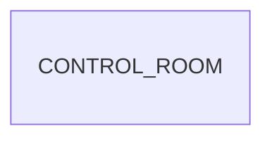

L'exploitation a besoin d'un seul écran pour deux infrastructures qui se
répondent : le parc Proxmox et les clusters Kubernetes. `proxmox_tenant`
synchronise déjà un miroir local, `odoo_herd` connaît déjà les clusters et
leurs kubeconfigs ; ce module ne fait que les lire et les présenter ensemble.
C'est ce qui justifie de le séparer des modules qui possèdent la donnée : il ne
synchronise rien et n'écrit rien.

Tout est calculé côté serveur au moment de l'ouverture, à partir des miroirs :
le tableau ne contacte jamais l'hyperviseur. Chaque chiffre porte l'âge de
l'instantané (`synced_at`), parce qu'une donnée périmée présentée comme live est
pire que pas de donnée. Les alertes sont des ratios calculés à la lecture —
mémoire au-dessus de 90 % en avertissement, 97 % en critique — et non des
seuils stockés. Pour Kubernetes, chaque cluster est lu séparément : une
exception est capturée par cluster et rapportée dans son entrée, sans masquer
les autres.

Deux effets de bord utiles : l'agrégation Kubernetes est isolée dans
`summarize_kubernetes`, une fonction pure testable sans serveur ; et le module
importe `kubernetes` au chargement, bibliothèque fournie par la dépendance
`odoo_herd`. Le menu est réservé au groupe
`proxmox_tenant.group_proxmox_manager`, et le rafraîchissement de 60 secondes ne
tourne que tant que la page est ouverte.

## Modèle de données

Le module n'enregistre aucun modèle persistant : `control.room` est un `AbstractModel` (service de calcul des instantanés de la salle de contrôle (AbstractModel, sans table)). Le diagramme le représente seul.

