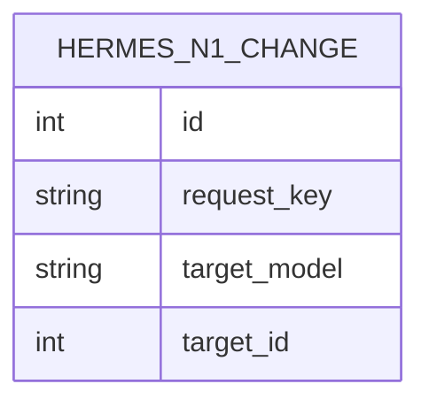

Un assistant qui écrit dans la base doit pouvoir le faire avec les droits de la
personne qui le lui demande, et laisser une trace qu'on ne peut pas réécrire.
C'est le contrat de ce module : il fournit la façade d'écriture de l'agent N1 et
le journal `hermes.n1.change`. Il est séparé de `hermes_activity` (l'affichage
dans Discuss) et de `hermes_n1_website` (le cas particulier des pages web), qui
s'appuient tous deux sur lui.

Chaque appel porte un contexte Discuss : un message source d'un administrateur,
de moins d'une heure, dans une conversation privée entre l'agent et ce
demandeur. La façade agit ensuite avec les droits ORM du demandeur, jamais avec
`sudo`. Pour l'historique, l'écriture est encadrée par un savepoint, un verrou
consultatif PostgreSQL et une clé d'idempotence calculée sur l'appel : un rejeu
identique renvoie la modification déjà faite au lieu d'en créer une seconde. La
ligne d'audit et la note du chatter sont créées dans la même transaction ; un
échec du journal annule l'opération.

Deux périmètres cohabitent. Les anciens appels `modifier`/`capabilities`
restent bornés à une liste blanche de champs sur douze modèles métier. La façade
moderne (`explorer`, `lire_metier`, `corriger_metier`, `agir_metier`) découvre
les modèles persistants et exclut les préfixes techniques et sensibles (`ir.`,
`base.`, `hermes.`, `k8s.`, `payment.`…), interdit les créations imbriquées dans
les relations et protège les documents validés. `data/neutralize.sql` désactive
enfin tout compte portant un groupe `hermes_*` sur une copie neutralisée, pour
qu'un staging cloné ne soit jamais piloté par un agent.

## Modèle de données

Le journal référence des modèles externes au module sans les posséder :
`res.users` (demandeur et agent) et `mail.message` (message source et note du
chatter), tous deux en Many2one avec suppression restreinte.
