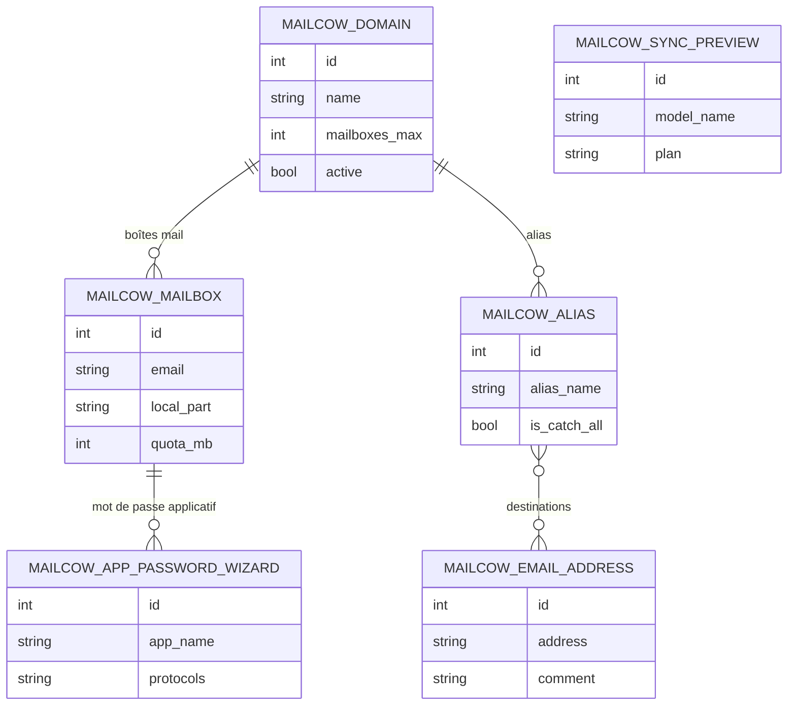

Un exploitant de tenant (diverse-cite.com, …) doit administrer son serveur
Mailcow depuis Odoo : domaines, boîtes mail, alias et adresses de destination,
sans passer par l'interface d'administration de Mailcow et sans perdre la vue
d'ensemble — quotas, occupation, comptes dormants, DKIM, TLS. Mailcow reste la
référence ; Odoo en tient une copie interrogeable, qui alimente aussi les
tableaux de bord du module `mailcow`.

L'approche est « copie locale, écritures explicites ». La synchronisation lit le
serveur et aligne Odoo sans jamais écrire sur Mailcow : les listes se
rafraîchissent seules à l'ouverture, au plus une fois par minute, et une fiche
absente du serveur est marquée « non synchronisée » plutôt que supprimée — d'où
la distinction entre une fiche jamais poussée et une fiche disparue. Les
créations, mises à jour et suppressions passent par des boutons qui appellent
l'API, avec les droits vérifiés dans le code (`_exiger`) et pas seulement sur le
bouton : un bouton se contourne par RPC. Les mots de passe sont fabriqués par
Odoo, affichés une seule fois et stockés nulle part ; une migration supprime
même les colonnes que les versions précédentes gardaient.

Le module porte les réglages de connexion et trois groupes : *Lecture et
synchronisation* (lire et aligner, le groupe des agents), *Utilisateur* (créer
et mettre à jour) et *Gestionnaire* (cumule les deux, ajoute les suppressions et
les mots de passe). La clé API peut venir de la variable d'environnement
`MAILCOW_API_KEY`, ignorée sur une base neutralisée ; à défaut elle est rangée
dans `mailcow.api_key`. Le périmètre d'un tenant se borne par le paramètre
`mailcow.allowed_domains`. Les écrans d'ensemble côté usager vivent dans
`mailcow`, l'entretien du serveur dans `mailcow_server` ; un `pre_init_hook`
reprend les xmlids de l'ancien `mailcow_admin` pour que la mise à jour ne perde
ni menus ni groupes.

## Modèle de données

