Un parc d'instances Odoo tourne sur Kubernetes, piloté par l'opérateur Bemade
(ressources `OdooInstance`, `OdooBackupJob`, `OdooUpgradeJob`, …). Sans outil,
chaque création, sauvegarde, restauration, mise à jour ou resynchronisation de
staging se fait en kubectl et en YAML. `odoo_herd` ramène ces gestes dans Odoo :
clusters, instances, modèles d'instance, sauvegardes S3/MinIO, travaux et
tableau de bord, y compris pour un staging hébergé sur un autre cluster.

L'approche sépare nettement ce qui est **désiré** de ce qui est **constaté**. La
fiche d'une instance garde les champs éditables à envoyer et des champs
`current_*` relus du cluster ; *Sync to Cluster* n'envoie que les champs
modifiés (`edited_fields`), *Reset to Current* revient aux valeurs du cluster.
Les travaux de l'opérateur sont créés **après le commit** de la transaction — un
retry Odoo ne doit pas relancer trois fois le même travail — et leur état est
relu du cluster par une tâche planifiée, parce qu'un webhook peut se perdre quand
Odoo redémarre à la fin d'une mise à jour.

Les webhooks HTTP des travaux sont `auth="public"` et protégés par un jeton
Bearer propre à chaque travail ; l'état d'une instance passe par un webhook de
cluster, avec un jeton en paramètre d'URL. Sans retour du webhook, la tâche de
relecture reprend la main au bout de deux minutes. C'est le socle de `odoo_herd_portal`,
qui y ajoute la barrière humaine des mises en production et les façades des
agents. Le module vient de Bemade Inc., porté en 20.0 par Diverse-Cité ; il
dépend de bibliothèques Python hors Odoo (`kubernetes`, `pyyaml`, `boto3`,
`openupgradelib`).

## Modèle de données

```mermaid
erDiagram
    K8S_CLUSTER {
        int id
        string name
        string api_endpoint
        string connection_status
    }
    K8S_ODOO_INSTANCE {
        int id
        string name
        string environment
        string phase
    }
    K8S_ODOO_INSTANCE_TEMPLATE {
        int id
        string name
        string image
        string filestore_size
    }
    K8S_S3_CONFIG {
        int id
        string name
        string bucket
        string region
    }
    K8S_ODOO_BACKUP {
        int id
        string name
        string state
        string object_key
    }
    K8S_ODOO_RESTORE {
        int id
        string name
        string state
        bool neutralize
    }
    K8S_ODOO_UPGRADE {
        int id
        string name
        string state
        string modules
    }
    K8S_ODOO_STAGING_REFRESH {
        int id
        string name
        string state
        string filestore_method
    }
    K8S_ODOO_INSTANCE_BACKUP_SCHEDULE {
        int id
        int interval_number
        string interval_type
        int keep_count
    }
    K8S_SPEC_VIEWER {
        int id
        string title
        string content
    }
    K8S_BACKUP_WIZARD {
        int id
        string format
        bool with_filestore
    }
    K8S_CLUSTER_TEST_WIZARD {
        int id
        string state
        string test_result
    }
    K8S_CREATE_INSTANCE_WIZARD {
        int id
        string name
        string environment
        string initialization_mode
    }
    K8S_DELETE_INSTANCE_WIZARD {
        int id
        string instance_name
        string confirmation_text
    }
    K8S_RESTORE_BACKUP_WIZARD {
        int id
        string confirmation_name
        bool neutralize
    }
    K8S_STAGING_REFRESH_WIZARD {
        int id
        string confirmation_name
        string filestore_method
    }
    K8S_SYNC_INSTANCES_WIZARD {
        int id
        bool sync_all
        string state
    }
    K8S_UPGRADE_WIZARD {
        int id
        string modules
        string modules_install
    }
    K8S_UPLOAD_BACKUP_WIZARD {
        int id
        string backup_name
        string state
    }
    K8S_ODOO_INSTANCE_TEMPLATE ||--o{ K8S_CLUSTER : "modèle par défaut"
    K8S_S3_CONFIG ||--o{ K8S_CLUSTER : "config S3"
    K8S_CLUSTER ||--o{ K8S_ODOO_INSTANCE : "instances"
    K8S_ODOO_INSTANCE ||--o{ K8S_ODOO_INSTANCE : "production d'un staging"
    K8S_ODOO_INSTANCE ||--o{ K8S_ODOO_BACKUP : "sauvegardes"
    K8S_CLUSTER ||--o{ K8S_ODOO_BACKUP : "cluster"
    K8S_S3_CONFIG ||--o{ K8S_ODOO_BACKUP : "destination"
    K8S_ODOO_INSTANCE ||--o{ K8S_ODOO_INSTANCE_BACKUP_SCHEDULE : "planifications"
    K8S_CLUSTER ||--o{ K8S_ODOO_INSTANCE_BACKUP_SCHEDULE : "cluster"
    K8S_ODOO_INSTANCE_BACKUP_SCHEDULE ||--o{ K8S_ODOO_BACKUP : "sauvegardes planifiées"
    K8S_ODOO_BACKUP ||--o{ K8S_ODOO_RESTORE : "restaurations"
    K8S_ODOO_INSTANCE ||--o{ K8S_ODOO_RESTORE : "instance cible"
    K8S_CLUSTER ||--o{ K8S_ODOO_RESTORE : "cluster"
    K8S_ODOO_INSTANCE ||--o{ K8S_ODOO_UPGRADE : "mises à jour"
    K8S_CLUSTER ||--o{ K8S_ODOO_UPGRADE : "cluster"
    K8S_ODOO_INSTANCE ||--o{ K8S_ODOO_STAGING_REFRESH : "staging cible"
    K8S_ODOO_INSTANCE ||--o{ K8S_ODOO_STAGING_REFRESH : "production source"
    K8S_CLUSTER ||--o{ K8S_ODOO_STAGING_REFRESH : "cluster"
    K8S_ODOO_INSTANCE ||--o{ K8S_BACKUP_WIZARD : "sauvegarde"
    K8S_CLUSTER ||--o{ K8S_BACKUP_WIZARD : "cluster"
    K8S_CLUSTER ||--o{ K8S_CLUSTER_TEST_WIZARD : "test"
    K8S_CLUSTER ||--o{ K8S_CREATE_INSTANCE_WIZARD : "création"
    K8S_ODOO_INSTANCE_TEMPLATE ||--o{ K8S_CREATE_INSTANCE_WIZARD : "modèle"
    K8S_ODOO_INSTANCE ||--o{ K8S_CREATE_INSTANCE_WIZARD : "production source"
    K8S_ODOO_BACKUP ||--o{ K8S_CREATE_INSTANCE_WIZARD : "sauvegarde source"
    K8S_ODOO_INSTANCE ||--o{ K8S_DELETE_INSTANCE_WIZARD : "suppression"
    K8S_ODOO_BACKUP ||--o{ K8S_RESTORE_BACKUP_WIZARD : "restauration"
    K8S_ODOO_INSTANCE ||--o{ K8S_RESTORE_BACKUP_WIZARD : "instance cible"
    K8S_CLUSTER ||--o{ K8S_RESTORE_BACKUP_WIZARD : "cluster"
    K8S_ODOO_INSTANCE ||--o{ K8S_STAGING_REFRESH_WIZARD : "staging cible"
    K8S_ODOO_INSTANCE ||--o{ K8S_STAGING_REFRESH_WIZARD : "production source"
    K8S_CLUSTER ||--o{ K8S_STAGING_REFRESH_WIZARD : "cluster"
    K8S_CLUSTER }o--o{ K8S_SYNC_INSTANCES_WIZARD : "synchronisation"
    K8S_ODOO_INSTANCE ||--o{ K8S_UPGRADE_WIZARD : "mise à jour"
    K8S_ODOO_INSTANCE ||--o{ K8S_UPLOAD_BACKUP_WIZARD : "envoi"
    K8S_CLUSTER ||--o{ K8S_UPLOAD_BACKUP_WIZARD : "cluster"
```

