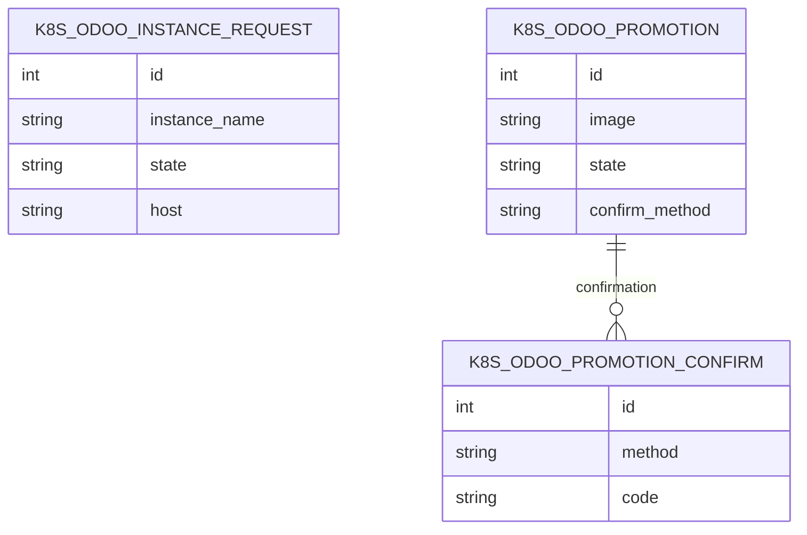

Un client d'une production Odoo gérée par l'herd n'a pas d'accès au backend
d'administration. Le portail lui donne une page `/my/odoo` : l'état de sa
production et de son staging, la resynchronisation du staging depuis la
production, et la demande de « passer la production au code du staging ». Un
client sans base peut aussi demander une nouvelle base depuis le portail.

La règle centrale est que rien ne part en production sans un humain. Une mise en
production fige l'image du staging par son empreinte (`…@sha256:`) et reste en
attente jusqu'à la confirmation d'un approbateur ; le code de confirmation est
soit celui de l'application d'authentification (vérifié par Odoo), soit un code
à six chiffres envoyé par courriel (10 minutes, 5 essais, une demande par
minute), dont seule une empreinte HMAC est stockée. Les agents sont reconnus à
leurs groupes, jamais au contexte : ils peuvent préparer une demande ou déployer
sur un staging ouvert, mais ne confirment jamais. Une demande confirmée est
figée, et une mise en production dont la production a changé depuis est refusée
au lieu de la ramener en arrière.

Le module ajoute aussi la demande de base : nom validé, hôte provisoire
`<nom>.herd-pending.invalid` le temps de remplacer `admin/admin` par le compte
du client, puis hôte réel et envoi des accès par courriel. Les copies
neutralisées sont protégées par `data/neutralize.sql` (clusters désactivés,
comptes d'agents désactivés et clés API supprimées) : un staging de l'herd ne
pilote jamais un vrai cluster. Il dépend d'`odoo_herd`, de `portal` et de
`auth_totp` / `auth_totp_portal`.

## Modèle de données

Les instances, tâches, offres et clients visés sont déclarés par `odoo_herd` ou
par le cœur d'Odoo : relations externes, hors de ce bloc.
