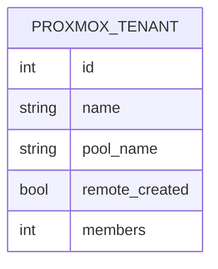

Un hébergeur qui vend des machines Proxmox doit créer, un par un, les tenants de
ses clients : un tenant est un pool du cluster, sur un serveur donné, avec un
identifiant de pool. `proxmox_server` porte ce côté plateforme — créer le pool
sur l'API, le relire, le supprimer sous garde, et fabriquer la fiche serveur
bornée à ce pool que l'instance Odoo du tenant déclarera.

L'approche est volontairement prudente. La suppression est refusée tant que le
pool porte des membres : le module ne supprime jamais les machines d'un client.
Chaque geste est journalisé dans le fil de la fiche du tenant, avec l'auteur et
l'heure. La fiche `proxmox.server` du tenant est créée par recopie de l'URL et du
jeton du serveur de plateforme, avec `allowed_pools` limité au pool : c'est cette
fiche, et pas un réglage global, que l'instance du tenant utilisera.

Le module dépend de `proxmox_tenant` (modèles serveur, nœuds, machines, pools,
stockages et client API) et en réutilise les groupes : son groupe *Proxmox —
Opérateur de plateforme* implique *Proxmox — Gestionnaire*, donc un opérateur de
plateforme gère aussi le miroir. Son menu s'ajoute sous *Proxmox*, fourni par
`proxmox_tenant`. Il n'ajoute ni réglage, ni tâche planifiée.

## Modèle de données

La fiche est reliée à un `proxmox.server` (module `proxmox_tenant`) : relation
externe, hors de ce bloc.
