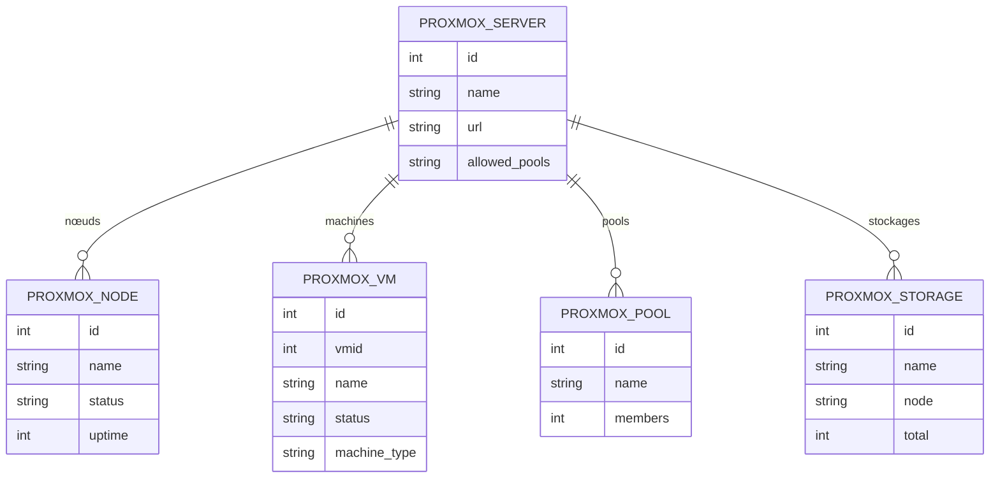

Une instance Odoo de tenant doit voir les machines Proxmox de son client —
nœuds, VM et conteneurs, pools, stockages — sans accéder au reste du cluster.
`proxmox_tenant` en tient un miroir : chaque serveur porte son URL et son jeton
API, et le champ *Pools du tenant* borne ce que l'instance rapatrie.

Le miroir est rafraîchi à l'ouverture des vues de liste, au plus une fois par
minute et par objet, sans bouton : l'écran n'attend pas, et une panne du serveur
n'efface pas le dernier état connu — l'échec part au journal du serveur. Les
champs venus de Proxmox sont `readonly` ; les seules actions sont les gestes de
cycle de vie d'une machine — démarrer, éteindre, redémarrer, arrêt forcé —,
postés à l'API puis notés dans le fil, et la date de synchronisation de la
machine est vidée pour forcer sa relecture. Les tailles en octets passent par un
`BigInteger` maison (`int8`) car `fields.Integer` plafonne à 2,1 milliards.

Un jeton par serveur, pas de paramètre global : chaque fiche serveur a sa clé,
réservée au groupe *Gestionnaire*. Un `allowed_pools` vide laisse tout le serveur
visible — le cas de l'exploitant. Les groupes emboîtés *Lecture et
synchronisation* → *Utilisateur* → *Gestionnaire* règlent les droits. Le module
est le support de `proxmox_server` et alimente la salle de contrôle
(`hermes_control_room`), qui lit `proxmox.server`, `proxmox.node` et
`proxmox.vm` sans appeler l'API Proxmox.

## Modèle de données

