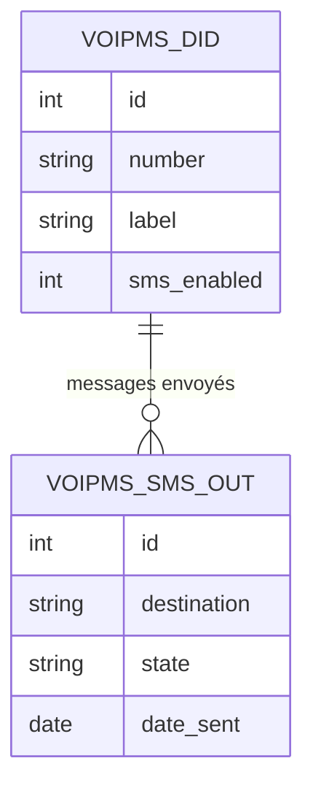

Diverse-Cité envoie des SMS de service depuis Odoo par le compte VoIP.ms (API
REST v1). `voipms_sms` fournit la boîte d'envoi et le registre des DID
émetteurs : on choisit un numéro du compte, on écrit le message, on l'envoie, et
l'historique garde l'état, la date et les identifiants VoIP.ms.

Deux contraintes du canal façonnent le module. Un `sendSMS` de plus de 150
caractères est rejeté : les messages longs sont découpés localement en segments
`n/N` sur des limites de mots, et un message de plus de 1600 caractères est
refusé avant tout appel. Un numéro NANP est normalisé en 11 chiffres. L'échec
d'un envoi est consigné sur la ligne (`Échec` + message) plutôt que levé : un
rollback effacerait l'historique de la tentative, qui est justement ce que la
boîte d'envoi doit garder.

Le client (urllib, sans dépendance) impose son propre `User-Agent` — VoIP.ms
répond 403 au `User-Agent` par défaut de Python — et n'expose jamais l'URL dans
ses messages d'erreur, car les identifiants y figurent en clair. Les réglages
(`voipms.api_username`, `voipms.api_token`) sont dans *Réglages* > *SMS VoIP.ms*
et stockés dans `ir.config_parameter`. Deux groupes : *Utilisateur SMS* pour le
menu et l'envoi, *Gestionnaire SMS* pour la gestion complète. `wazo_voipms`
réutilise ce client et étend `voipms.did` pour router les appels entrants.

## Modèle de données

