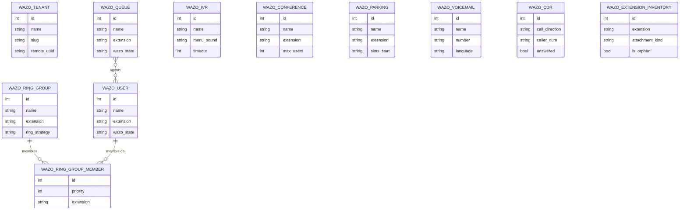

L'opérateur d'un tenant Wazo exploite la téléphonie de son client depuis Odoo :
usagers et postes, groupes d'appel, files d'attente, menus vocaux, salles de
conférence, parcs de stationnement, messageries vocales, et le journal
d'appels. C'est la couche « exploitation d'un tenant », par opposition à
`wazo_server` (l'exploitant de la plateforme) et à `wazo_phone` (l'usage :
tableau de bord, bouclage d'appel, softphone).

Le PBX fait autorité : chaque objet porte un état `new` / `synced` / `error`,
un message d'erreur et les identifiants distants qui permettent une reprise
idempotente. Les flux de création sont multi-appels — poste, ligne, utilisateur,
messagerie puis compte d'authentification pour un usager ; groupe, poste puis
remplacement de l'ensemble des membres pour un groupe d'appel — et un échec
indique l'étape. Chaque écriture distante est définitive même si la transaction
Odoo est annulée par la suite. Les plages d'extensions sont lues dans Wazo
(`contextnumbers`), et un numéro hors plage, d'un autre type ou déjà en service
est refusé avant toute écriture.

Deux objets méritent leur forme : le membre de groupe d'appel est un modèle — et
non un `Many2many` — parce qu'il porte la priorité de sonnerie ; l'inventaire des
postes est un modèle transitoire reconstruit à chaque chargement, seul moyen de
voir les extensions orphelines que rien d'autre n'affiche. Le journal d'appels
est une copie synchronisée depuis `wazo-call-logd` par une tâche planifiée
(toutes les heures, inactive par défaut) ou par le bouton manuel — pas en temps
réel. Les réglages portent URL, jeton, tenant, contexte des lignes, langue des
messageries et vérification TLS ; `wazo_phone` étend ces modèles, `wazo_server`
s'appuie dessus et `wazo_voipms` route les DID vers leurs destinations.

## Modèle de données

