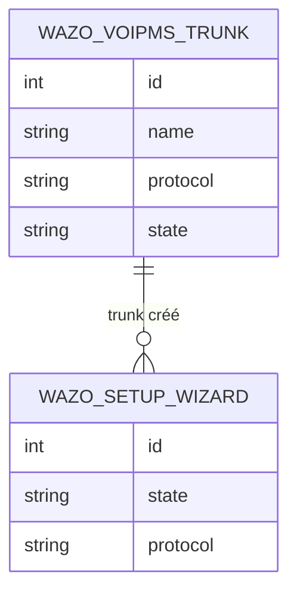

Un tenant Wazo doit joindre le RTC et recevoir ses numéros. `wazo_voipms` fait le
pont avec VoIP.ms dans les deux sens : un sous-compte SIP (ou IAX2) VoIP.ms, un
endpoint, un trunk et un outcall côté Wazo pour sortir par
`<préfixe><numéro>` ; et, pour l'entrant, un incall dans `from-extern` puis un
routage `sip:<DID>@<hôte Wazo>` posé chez VoIP.ms.

Le provisionnement est idempotent par identifiants distants : chaque étape
(VoIP.ms puis Wazo) note ce qu'elle a créé, et *Réessayer* reprend un
provisionnement en erreur sans recréer l'existant. Un sous-compte VoIP.ms est
mono-protocole (SIP ou IAX2) : le choix décide de la jambe Wazo ↔ VoIP.ms, les
usagers restant en WebRTC/SIP vers Wazo. IAX2 traverse le NAT sans port ouvert
et l'entrant arrive par l'enregistrement ; SIP exige que Wazo soit joignable
publiquement. Un trunk porte un `tenant_slug` : chaque Odoo de tenant ne route
que ses propres DIDs, quand l'instance de la plateforme les voit tous.

La destination d'un entrant est unique — utilisateur, groupe, file, IVR,
conférence ou messagerie —, validée par contrainte : Wazo n'accepte qu'une
destination par incall. L'assistant de première configuration enchaîne trunk,
usager et groupe d'appel en réutilisant les actions existantes. Le module dépend
de `wazo_tenant` et de `voipms_sms`, dont il réutilise les clients ; il
s'installe sur l'Odoo du tenant, et sur celui de la plateforme qui doit voir tous
les DIDs.

## Modèle de données

L'assistant vise aussi `wazo.user` et `wazo.ring.group`, déclarés par
`wazo_tenant` : relations externes, hors de ce bloc.
